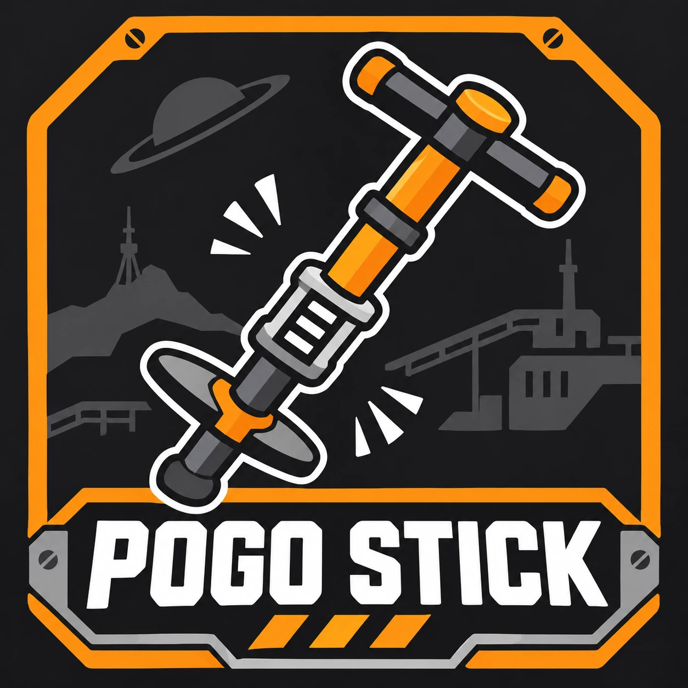

# Pogo Stick

A [Satisfactory](https://www.satisfactorygame.com/) mod that adds an equippable Pogo Stick.
Charge it, push off the surface you're looking at, and launch the opposite way.

Built with [SML](https://ficsit.app/mod/SML) (Satisfactory Mod Loader).

## Features

- Unlocked with the **Jump Pads** milestone (Tier 2) and crafted in the Equipment Workshop
  from 10 Iron Rods, 5 Iron Plates and 25 Screws
- Hold **Primary Fire** to charge. A full charge pushes off the surface you're looking at
  and launches you the opposite way: look down to go up, look at a wall to fly away from it.
  It only launches when that surface is within reach, so looking at the sky does nothing.
- A HUD marker shows the push-off point, green when it's in reach and red when it's too
  far, with its distance
- Land hard while looking at the ground and you bounce back up instead of taking damage.
  Hold Primary Fire or crouch as you land to stop.
- No fall damage between a launch and your next landing
- Plays the Jump Pad launch sound
- Every setting is configurable in-game from the mod settings menu and applies live,
  no restart needed

## Configuration

| Setting | Description | Default |
| --- | --- | --- |
| Charge Time | Seconds Primary Fire must be held for a full charge | 1 s |
| Launch Strength | How fast a full charge launches you | 25 m/s |
| Push-Off Range | How close the surface you're looking at must be. Standing up, the floor is about 1.7 m away | 3.5 m |
| Cooldown | Seconds after a launch before you can charge again | 0.5 s |
| Keep Momentum | Adds the launch to your current speed instead of replacing it | Off |
| Launch When Fully Charged | Launch the moment the charge completes, instead of on release | On |
| No Fall Damage After Launch | No fall damage until your next landing | On |
| Spring Squash | How much the spring visibly squashes at full charge | 1 |
| Bounce On Landing | Bounce back up from hard landings while looking at the ground | On |
| Bounciness | Fraction of landing speed a bounce gives back. 1 = bounce forever | 0.8 |
| Minimum Bounce Speed | Slower landings don't bounce | 12 m/s |
| Show Push-Off Point | Show the HUD marker | On |
| Show Push-Off Distance | Show the distance next to the marker | On |

**Hold Position (advanced):** the stick's size (default 0.7, scaled around the grip) and
its offset and rotation relative to your hand.

## Known limitations

- Tested in single player only. Multiplayer and dedicated servers are untested.
- Only you hear the launch sound. Other players don't.
- In third person the character holds the stick with a one-handed pose. The two-handed
  pose scales the character's upper body for equipment added by mods.

## Installation

Install via the [Satisfactory Mod Manager](https://ficsit.app/).

## Building from source

1. Clone into `<SML>/Mods/GameFeatures/PogoStick` (or symlink/junction it there).
2. Generate project files and build the `FactoryEditor` target as you would for SML.
3. Package with Alpakit.

The art is imported from FBX and PNG sources with `Tools/import_art.py`, run headlessly
through the editor's Python commandlet. See the comment at the top of the script.
